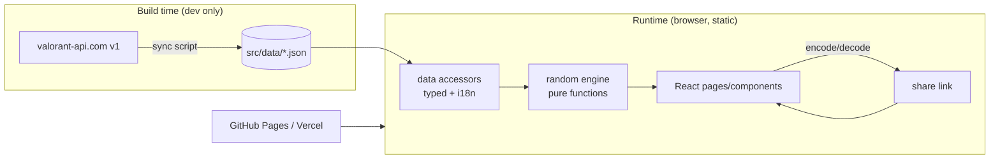
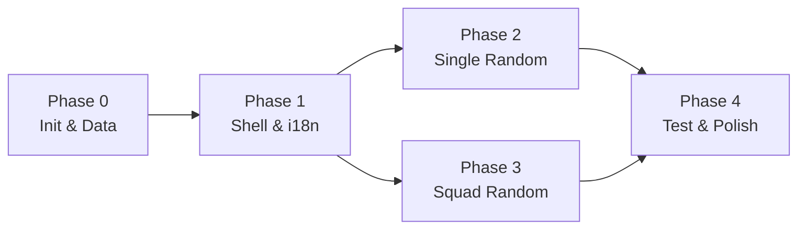

# VALORANDOM — STEP 2 (Tài liệu chuẩn) + Planning STEP 3

> Trạng thái: **Review Plan** — chưa có source code nào. Plan này chứa nội dung 4 tài liệu chuẩn để review, kèm kế hoạch Phase for STEP 3.
> Repo hiện tại: `D:\Valorandom`, git `main`, chưa có commit, chỉ có `quy_trinh_ai_agent.md` và `.kilo/plans/`.

## 0. Quyết định đã chốt (input cho mọi tài liệu bên dưới)

| # | Quyết định | Giá trị |
|---|---|---|
| D1 | Nguồn dữ liệu | Static JSON sinh 1 lần từ valorant-api.com bằng script, commit vào repo. App không gọi mạng khi chạy. |
| D2 | Tech stack | Vite + React 18 + TypeScript + Tailwind CSS + Framer Motion (`motion`) |
| D3 | Ngôn ngữ UI | Song ngữ VN/EN có toggle, lưu `localStorage`. Tên Agent/Map/Weapon lấy localized từ API cho cả 2 ngôn ngữ. |
| D4 | Phạm vi Squad | Core (role per slot, không trùng agent) + Lock + Share link qua URL |
| D5 | Ngữ nghĩa Flex | Flex **lấp role còn thiếu** trong đội trước, hết role thiếu thì random tự do |
| D6 | Testing | Vitest + React Testing Library (unit/component) + Playwright (e2e) |
| D7 | Deploy | Static build, hash router để chạy được trên GH Pages/Vercel/Netlify không cần rewrite rule |
| D8 | Package manager | pnpm (fallback npm nếu môi trường không có) |

Các tài liệu dưới đây sẽ được materialize thành file thật trong Phase 0 tại `docs/01-prd.md`, `docs/02-solution-architecture.md`, `docs/03-data-schema-and-api.md`, `docs/04-implementation-plan.md`.

---

# 1. PRD — `docs/01-prd.md`

## 1.1 Problem

Khi chơi Valorant theo nhóm, đội 5 người thường mất 1–3 phút tranh luận "ai chơi con gì, role gì" trước mỗi trận, đặc biệt khi chơi custom, scrim, hoặc chơi cùng người mới. Vấn đề cụ thể:

- **P1 — Chọn đặc vụ thủ công gây tranh cãi và chậm.** Không có ai "chốt", mọi người chọn theo sở thích dẫn tới đội thiếu role (4 duelist, 0 controller).
- **P2 — Trùng đặc vụ.** Random thủ công (bốc tay, random số) rất dễ ra 2 người cùng đặc vụ → luật chơi không cho phép.
- **P3 — Thiếu "công cụ chơi vui".** Các tool random hiện có thường chỉ random 1 thứ (map hoặc agent), UI khô, không có chế độ đội.
- **P4 — Thiếu tính tái lập/chia sẻ.** Khi đội đã random xong, người vào muộn không biết kết quả; không có link để gửi lại.

## 1.2 Context

- **Người dùng:** nhóm 1–5 người chơi Valorant, phổ thông (không cần đăng nhập, không cần cài đặt), dùng cả desktop lẫn mobile trong lúc chờ vào trận.
- **Bối cảnh sử dụng:** trong lobby Discord/Zalo, thời gian vàng là ~10–20 giây. Mọi thao tác phải xong trong 3 click từ lúc mở trang.
- **Ràng buộc sản phẩm:** không tài khoản, không backend, không lưu dữ liệu người dùng lên server. Chạy như static SPA.
- **Ràng buộc dữ liệu game:** pool đặc vụ thay đổi theo mùa (agent mới, map rotation). Cần cơ chế cập nhật dữ liệu nhưng không làm app phụ thuộc mạng lúc chạy.
- **Không nằm trong phạm vi (Out of scope) v1:** đăng nhập, lưu lịch sử đội trên server, Riot API/Sign-in, xếp hạng người chơi, gợi ý counter-pick theo đối thủ, tạo ảnh kết quả để share (chỉ share link text).

## 1.3 Personas

- **P-A "Captain" (người tổ chức):** mở tool, nhập 5 slot, chốt role, bấm random, gửi link vào chat đội.
- **P-B "Thành viên":** mở link share, xem mình được agent gì, thấy role của cả đội.
- **P-C "Người chơi đơn":** chỉ muốn random 1 map hoặc 1 weapon cho vui/thử thách.

## 1.4 Feature list

### Nhóm A — Nền tảng

| ID | Feature | Mô tả | Ưu tiên |
|---|---|---|---|
| Ft-01 | App shell & điều hướng | 2 route: `/` (Single Random), `/squad` (Squad Random). Header có logo, language toggle (VI/EN). Theme tối mặc định kiểu esports. | Must |
| Ft-02 | Data layer tĩnh | Agents/Maps/Weapons đọc từ JSON local qua module typed accessor. Không fetch mạng lúc runtime. | Must |
| Ft-03 | i18n VI/EN | Dictionary cho toàn bộ label UI + tên/đặc tả agent/map/weapon theo ngôn ngữ. Toggle lưu localStorage, mặc định `vi`. | Must |
| Ft-04 | Error/empty states | Trường hợp pool rỗng sau filter, slot chưa đủ tên, share link hỏng → hiển thị thông báo rõ, không crash. | Must |

### Nhóm B — Single Random

| ID | Feature | Mô tả | Ưu tiên |
|---|---|---|---|
| Ft-10 | Random Agent | Random 1 đặc vụ. Filter theo role (Duelist/Initiator/Controller/Sentinel). | Must |
| Ft-11 | Random Map | Random 1 bản đồ. Filter: "chỉ map đang trong rotation" (cờ `active` trong JSON). | Must |
| Ft-12 | Random Weapon | Random 1 vũ khí. Filter theo category (Sidearm/SMG/Shotgun/Rifle/Sniper/LMG/Melee) và khoảng giá. | Must |
| Ft-13 | Re-roll & animation | Nút "Random lại" random lại ngay, animation lật/rung thẻ, highlight kết quả mới. | Should |
| Ft-14 | Random Combo (Nice-to-have) | 1 nút random đồng thời Agent + Map + Weapon ("Thử thách trận đấu"). | Could |

### Nhóm C — Squad Random (trọng tâm)

| ID | Feature | Mô tả | Ưu tiên |
|---|---|---|---|
| Ft-20 | Quản lý slot | Thêm/xóa slot, tối thiểu 1, tối đa 5. Mỗi slot có tên (mặc định "Player N") và role mong muốn ∈ {Duelist, Initiator, Controller, Sentinel, Flex}. | Must |
| Ft-21 | Random đội không trùng đặc vụ | Random gán đặc vụ cho từng slot, đảm bảo mọi agentId trong đội là duy nhất và agent đúng role của slot. | Must |
| Ft-22 | Flex lấp role thiếu | Slot Flex được ưu tiên gán vào role mà đội còn thiếu, trước khi random tự do. | Must |
| Ft-23 | Lock kết quả | Mỗi slot có nút Lock để giữ nguyên agent khi random lại. Lock tồn tại đến khi user mở hoặc đổi role của slot. | Must |
| Ft-24 | Share link | Mã hóa state đội (tên + role + lock + agent nếu có) vào URL; mở link khôi phục đúng đội và kết quả. | Must |
| Ft-25 | Cảnh báo bất khả thi | Nếu cấu hình role không thể thỏa (vượt quá pool role khả dụng) → báo lỗi rõ trước/sau khi random. | Must |
| Ft-26 | Hiển thị tổng quan đội | Bảng kết quả hiện tên người, role slot, agent được gán, role thực tế của agent, và cảnh báo nếu đội thiếu role (khi có nhiều Flex). | Should |

## 1.5 Acceptance Criteria

Format: **AC-<Ft>.<n>** — kiểm chứng được bằng test tự động (unit/component/e2e) trừ khi ghi chú `[manual]`.

### Ft-01–Ft-04

- **AC-01.1** Truy cập `/` render trang Single Random với 3 tab/card: Agent, Map, Weapon. Không có network request nào tới `*.valorant-api.com` khi chạy (verify bằng Playwright `page.route` chặn domain → app vẫn hoạt động).
- **AC-01.2** Toggle VI/EN đổi toàn bộ label UI và tên agent/map/weapon; reload trang giữ nguyên ngôn ngữ đã chọn.
- **AC-01.3** Route `/squad` mở trực tiếp được trên static hosting (hash router), không 404 khi reload.
- **AC-02.1** Module `src/data` export typed `agents`, `maps`, `weapons`; test data-integrity pass: mọi `id` duy nhất, mọi `role` ∈ enum, mọi `category` ∈ enum, mọi phần tử có `displayName.vi` và `displayName.en` không rỗng.
- **AC-04.1** Filter tạo ra pool rỗng → UI hiện empty state có text hướng dẫn, nút Random disabled; không throw error, không render `undefined`.
- **AC-04.2** Share link hỏng/không hợp lệ (sai schema, base64 lỗi, role lạ, >5 slot) → app load state mặc định + banner "Link không hợp lệ"; không crash trắng trang.

### Ft-10–Ft-13

- **AC-10.1** Với pool agent đã filter, bấm Random trả về đúng 1 agent nằm trong pool.
- **AC-10.2** Filter role = `Duelist` → 100% kết quả có `agent.role === 'duelist'` (test lặp 200 lần với RNG thật).
- **AC-10.3** Bấm Random lần 2 với pool > 1 phần tử có thể trả kết quả khác (không assert khác nhau tuyệt đối vì random; test bằng RNG seed cố định để deterministic).
- **AC-11.1** Filter "active only" → chỉ trả map có `active === true`.
- **AC-11.2** Map hiển thị tên + ảnh splash (lazy load) và danh sách site (A/B/C nếu có).
- **AC-12.1** Filter category + `costMin/costMax` → kết quả thỏa mọi điều kiện filter; test với ít nhất 3 tổ hợp filter.
- **AC-13.1** [manual] Animation chạy ≤ 600ms, không layout shift, không block nút Random lần tiếp theo quá 1 lần animation.
- **AC-13.2** Re-roll với RNG seed cố định tạo chuỗi kết quả deterministic (test thuần logic, không cần DOM).

### Ft-20–Ft-26 (Squad)

- **AC-20.1** Mặc định 5 slot. Xóa đến slot cuối cùng thì nút xóa disabled (tối thiểu 1 slot). Thêm slot khi đã có 5 thì nút thêm disabled.
- **AC-20.2** Bỏ trống tên → slot hiển thị nhãn mặc định `Player <n>`; nhãn cập nhật theo vị trí khi xóa slot giữa (hoặc giữ tên đã nhập, không reset tên của slot khác).
- **AC-20.3** State slot: `{ id, name, role, lockedAgentId | null }`. Đổi role của slot đang lock → lock bị xóa (vì agent có thể sai role) và UI phản ánh ngay.
- **AC-21.1 (trọng tâm)** Sau khi random, **tập agentId của toàn đội có kích thước bằng số slot** (không trùng). Test property: 5.000 lần lặp với mọi tổ hợp role hợp lệ (gồm cả tổ hợp toàn Flex và tổ hợp 5 cùng role) → assert uniqueness 100%.
- **AC-21.2 (trọng tâm)** Với slot role cố định (≠ Flex), agent được gán có `agent.role === slot.role` — 100% số lần, kể cả khi đội có 5 slot cùng 1 role (pool role đó phải đủ lớn; nếu không đủ → AC-25.1).
- **AC-21.3** Không bao giờ gán một agent đang bị lock ở slot khác cho slot không lock (agent đã dùng bị loại khỏi pool).
- **AC-22.1 (trọng tâm)** Cho team có `k` slot Flex và tập role còn thiếu `M` (|M| = m). Sau random: số slot Flex được gán vào role thuộc `M` bằng `min(k, m)` — trừ trường hợp pool các role đó cạn, khi đó fallback random tự do. Test bằng RNG seed cố định trên ≥ 20 tổ hợp (k, m).
- **AC-22.2** Ví dụ kiểm chứng cụ thể: slots = [Duelist, Flex, Flex, Flex, Flex] (5 slot) → agent của 3 slot Flex còn lại thuộc 3 role khác nhau trong {Initiator, Controller, Sentinel}, slot Flex thứ 4 random tự do. Test assert chính xác điều này.
- **AC-23.1** Lock slot 2 (agent X) → bấm Random lại → slot 2 vẫn là X, các slot không lock được random lại; không slot nào khác nhận X.
- **AC-23.2** Lock 5/5 slot → nút Random trả về đúng state cũ (không thay đổi), UI báo "Tất cả slot đã lock".
- **AC-23.3** Hai slot không thể lock cùng một agent: khi slot 1 đã lock X, danh sách chọn agent của slot 2 loại X (hoặc chọn X ở slot 2 tự động mở lock slot 1 — phải chọn 1 hành vi và test nó). **Quyết định: loại X khỏi danh sách chọn ở slot khác.**
- **AC-24.1** Bấm Share → clipboard có URL chứa state; mở URL ở tab ẩn danh → khôi phục đúng số slot, tên, role, lock và kết quả agent (nếu đã random).
- **AC-24.2** Share link round-trip: `decode(encode(state))` deep-equal `state` với 50 state sinh tự động (property test), bao gồm tên có dấu tiếng Việt và emoji.
- **AC-24.3** URL dài < 2.000 ký tự với 5 slot đầy đủ tên + lock.
- **AC-25.1** Cấu hình bất khả thi (ví dụ 5 slot Duelist nhưng pool Duelist sau filter/lock < 5) → khi bấm Random hiện lỗi cụ thể "Cần 5 Duelist nhưng chỉ có N khả dụng", **không** trả về kết quả trùng agent.

### 1.6 Non-functional requirements

- **NFR-1 Hiệu năng:** bundle JS chính < 200 KB gzip; LCP < 1.5s trên 4G giả lập; random (kể cả 5 slot có Flex) < 10ms trên máy tầm trung.
- **NFR-2 Mượt:** animation 60fps, dùng transform/opacity, tôn trọng `prefers-reduced-motion` (tắt animation, vẫn đổi kết quả).
- **NFR-3 Accessibility:** điều hướng bàn phím được toàn bộ luồng Squad; nút có `aria-label`; contrast đạt AA; kết quả random được announce qua `aria-live="polite"`.
- **NFR-4 Responsive:** dùng tốt ở 360px (mobile) đến 1920px; bảng 5 slot chuyển thành stack dọc ở mobile.
- **NFR-5 Không backend:** không có server, không cookie, không tracking; chỉ `localStorage` cho ngôn ngữ.
- **NFR-6 Data freshness:** JSON có `meta.generatedAt` + `meta.dataVersion`; hiển thị ngày dữ liệu ở footer.

---

# 2. Solution Architecture — `docs/02-solution-architecture.md`

## 2.1 Kiến trúc tổng thể

Static SPA, không backend. Toàn bộ logic random chạy client trong một module thuần (pure functions) để test được.



**Nguyên tắc kiến trúc:**
1. **Data → Logic → View một chiều.** Component không tự random; mọi quyết định random nằm ở `src/features/random/*` là pure function, nhận `(input, rng)` và trả kết quả. Đây là điều kiện để test 5.000 lần lặp.
2. **RNG injectable.** `type Rng = () => number`. Mặc định dùng `Math.random`; test dùng `mulberry32(seed)` để deterministic. Không dùng `Math.random()` trực tiếp trong logic nghiệp vụ.
3. **Không state library.** `useReducer` cho Squad + Context cho i18n. App đủ nhỏ, thêm Zustand/Redux là thừa.
4. **Không fetch runtime.** Không TanStack Query, không axios, không loading state cho data.
5. **Hash router** (`createHashRouter`) để deep link `/squad?s=...` hoạt động trên static host không có rewrite.

## 2.2 Tech stack & lý do

| Lớp | Lựa chọn | Lý do |
|---|---|---|
| Build | Vite 5 | Dev server/HMR nhanh nhất, build static đơn giản, bundle nhỏ |
| UI | React 18 + TypeScript strict | Hệ sinh thái animation/UI phong phú, type an toàn cho dữ liệu game |
| Style | Tailwind CSS 3 | Utility-first, dựng UI gaming nhanh, không CSS chết, dễ làm theme tối/neon |
| Animation | `motion` (Framer Motion) | Card flip, stagger, layout animation mượt; API declarative |
| Router | react-router-dom 6 (`createHashRouter`) | 2 route, share link, static-host friendly |
| Validation | zod | Validate JSON khi sync + validate share link lúc decode |
| Test unit | Vitest + jsdom | Cùng hệ Vite, nhanh |
| Test component | @testing-library/react + user-event | Test theo hành vi người dùng |
| Test e2e | Playwright | Chạy Chromium; verify luồng thật + clipboard/URL |
| Icon | lucide-react | Nhẹ, tree-shakable |
| Font | Google Fonts "Rajdhani"/"Chakra Petch" + system fallback | Cảm giác esports; self-host ở Phase 4 nếu cần offline |

Không dùng ở v1: SSR/Next.js (không cần SEO), backend (không có dữ liệu riêng tư), state library, component library nặng (MUI/AntD → phá vỡ ngôn ngữ thiết kế gaming).

## 2.3 Cấu trúc thư mục

```
D:\Valorandom\
├─ .kilo/plans/                        # plan file (tooling)
├─ docs/
│  ├─ 01-prd.md
│  ├─ 02-solution-architecture.md
│  ├─ 03-data-schema-and-api.md
│  └─ 04-implementation-plan.md
├─ scripts/
│  ├─ sync-valorant-data.ts            # gọi valorant-api -> ghi src/data/*.json
│  └─ validate-data.ts                 # kiểm tra integrity JSON (chạy trong CI + test)
├─ src/
│  ├─ main.tsx
│  ├─ App.tsx                          # router + providers
│  ├─ routes/
│  │  ├─ SingleRandomPage.tsx
│  │  └─ SquadRandomPage.tsx
│  ├─ features/
│  │  ├─ random/
│  │  │  ├─ rng.ts                     # Rng type, mulberry32, shuffle, pick
│  │  │  ├─ singleRandom.ts            # randomAgent/Map/Weapon + filter fns
│  │  │  ├─ squadRandom.ts             # ⭐ thuật toán đội (pure)
│  │  │  ├─ filters.ts                 # chuẩn hóa filter -> predicate
│  │  │  └─ __tests__/                 # unit tests đặt cạnh source
│  │  ├─ single/                       # component Single Random (AgentPanel, MapPanel, WeaponPanel)
│  │  └─ squad/
│  │     ├─ squadReducer.ts            # state machine của đội
│  │     ├─ SquadSlotRow.tsx
│  │     ├─ RoleSelect.tsx
│  │     ├─ AgentPickerPopover.tsx     # chọn agent khi lock
│  │     └─ SquadResultTable.tsx
│  ├─ components/
│  │  ├─ ui/                           # Button, Card, Toggle, Tooltip, Badge, EmptyState
│  │  └─ layout/                       # Header, LangToggle, Footer, PageShell
│  ├─ data/
│  │  ├─ agents.json
│  │  ├─ maps.json
│  │  ├─ weapons.json
│  │  ├─ meta.json                     # generatedAt, dataVersion, counts
│  │  └─ index.ts                      # typed accessors + lookup maps
│  ├─ lib/
│  │  ├─ shareLink.ts                  # encode/decode state <-> URL
│  │  ├─ i18n/                         # dictionary vi.ts, en.ts, I18nProvider, useI18n
│  │  └─ cn.ts                         # class merge helper
│  ├─ hooks/
│  │  ├─ useRandomizer.ts
│  │  └─ useReducedMotion.ts
│  ├─ types/                           # domain types dùng chung
│  │  ├─ valorant.ts                   # Agent, Map, Weapon, Role, WeaponCategory
│  │  └─ squad.ts                      # SquadSlot, SquadState, SquadResult
│  └─ styles/index.css                 # tailwind layers + tokens (màu neon, glow)
├─ tests/
│  ├─ setup.ts
│  └─ e2e/
│     ├─ single-random.spec.ts
│     └─ squad-random.spec.ts
├─ public/                             # favicon, og-image, fonts (self-host ở P4)
├─ .env.example                        # không cần runtime env; chỉ ghi chú
├─ index.html
├─ package.json / pnpm-lock.yaml
├─ tailwind.config.ts / postcss.config.js
├─ tsconfig.json / tsconfig.node.json
├─ vite.config.ts                      # alias @ -> src, test config
├─ playwright.config.ts
└─ AGENTS.md                           # constraints cho agent (sinh ở Phase 0)
```

**Quy ước:**
- Import tuyệt đối qua alias `@/` (không `../../..`).
- Mỗi file < 250 dòng; component chỉ render, logic ở `features/*`.
- Không import `src/data/*.json` trực tiếp từ component — luôn qua `@/data`.
- Tên file component PascalCase, module logic camelCase.

## 2.4 Thiết kế thuật toán Squad Random (phần quan trọng nhất)

### Input

```ts
type Role = 'duelist' | 'initiator' | 'controller' | 'sentinel';
type SlotRole = Role | 'flex';

interface SquadSlot {
  id: string;
  name: string;
  role: SlotRole;
  lockedAgentId: string | null;
}

interface SquadRandomInput {
  slots: SquadSlot[];              // 1..5
  pool: Agent[];                   // pool sau filter (mặc định = toàn bộ agent playable)
  rng: Rng;                        // injectable
}
```

### Thuật toán (7 bước)

```
1. VALIDATE
   - 1 <= slots.length <= 5, nếu không -> throw SquadError('INVALID_SLOT_COUNT')
   - mọi lockedAgentId phải tồn tại trong pool và unique -> nếu trùng/ thiếu -> SquadError('INVALID_LOCK')
   - với mỗi slot có lock và role != 'flex': agent.role phải === slot.role
     (UI đã clear lock khi đổi role, nhưng vẫn enforce ở đây vì share link có thể chứa state lạ)

2. KHỞI TẠO
   - available = new Map(pool.map(a => [a.id, a]))       // sẽ xóa dần khi đã dùng
   - assigned = new Map<slotId, AgentId>()
   - teamRoles = Set<Role>()

3. ÁP DỤNG LOCK (trước mọi bước khác)
   - với mỗi slot có lockedAgentId:
       assigned[slot.id] = lockedAgentId
       available.delete(lockedAgentId)     // ⭐ đảm bảo không slot nào khác nhận lại
       teamRoles.add(agent.role)

4. GÁN SLOT ROLE CỐ ĐỊNH (role != 'flex', chưa lock)
   - shuffle(fixedFreeSlots, rng)          // thứ tự ngẫu nhiên để công bằng giữa các slot
   - với mỗi slot:
       candidates = [...available.values()].filter(a => a.role === slot.role)
       nếu candidates.length === 0 -> throw SquadError('INSUFFICIENT_ROLE', { role, needed, availableCount })
       agent = pick(candidates, rng)
       assigned[slot.id] = agent.id; available.delete(agent.id); teamRoles.add(agent.role)

5. TÍNH ROLE CÒN THIẾU
   - ALL_ROLES = ['duelist','initiator','controller','sentinel']
   - missing = ALL_ROLES.filter(r => !teamRoles.has(r))

6. GÁN SLOT FLEX (theo thứ tự ngẫu nhiên)
   - shuffle(flexFreeSlots, rng)
   - với mỗi slot:
       // ưu tiên role còn thiếu VÀ còn agent khả dụng
       fillable = missing.filter(r => existsAgentWithRole(available, r))
       nếu fillable.length > 0:
           role = pick(fillable, rng)
           agent = pick(agentsWithRole(available, role), rng)
           missing = missing.filter(r => r !== role)       // ⭐ lấp xong thì loại khỏi "missing"
       ngược lại:
           // hết role thiếu có thể lấp -> random tự do trong toàn pool còn lại
           nếu available.size === 0 -> throw SquadError('EXHAUSTED_POOL')
           agent = pick([...available.values()], rng)
       assigned[slot.id] = agent.id; available.delete(agent.id); teamRoles.add(agent.role)

7. RETURN
   - trả về assignments map + agent objects + team summary
     { agents: Agent[], bySlot: Record<slotId, Agent>, warnings: SquadWarning[] }
   - warning ví dụ: TEAM_MISSING_ROLE (đội không có controller), FLEX_NOT_FILLED
```

### Bất biến (invariants — assert trong dev & test)

- **I1:** `assigned.size === slots.length`.
- **I2:** `new Set(assigned.values()).size === assigned.size` → **không trùng đặc vụ**.
- **I3:** mọi slot `role ≠ 'flex'` có `assignedAgent.role === slot.role`.
- **I4:** mọi lock được giữ nguyên.
- **I5:** số Flex được lấp vào `missing` lúc bắt đầu bước 6 bằng `min(k, |missing có pool khả dụng|)`.

### Độ phức tạp

O(n × p) với n ≤ 5 và p ≈ 29 agent → không đáng kể. Không cần tối ưu; ràng buộc thời gian < 10ms dễ dàng.

### Tại sao gán role cố định trước, Flex sau?

Nếu gán Flex trước, Flex có thể "cướp" agent của role mà slot cố định cần, khiến bước 4 thất bại hoặc phải backtracking. Thứ tự cố định → Flex → free đảm bảo **không cần backtracking**, và điều kiện bất khả thi được phát hiện đúng lúc (bước 4) với thông báo chính xác.

### Semantic của Reroll với Lock

`reroll(state)` = chạy lại toàn bộ thuật toán với `lockedAgentId` hiện tại. Hệ quả: **mọi slot không lock đều được random lại** (kể cả slot role cố định). Đây là hành vi có chủ đích, được ghi rõ trong UI tooltip ("Chỉ giữ slot đã lock").

## 2.5 Mô hình state

```ts
type SquadAction =
  | { type: 'ADD_SLOT' }
  | { type: 'REMOVE_SLOT'; id: string }
  | { type: 'SET_NAME'; id: string; name: string }
  | { type: 'SET_ROLE'; id: string; role: SlotRole }     // clear lock nếu role đổi
  | { type: 'LOCK_AGENT'; id: string; agentId: string }   // remove agent đó khỏi lock của slot khác
  | { type: 'UNLOCK_AGENT'; id: string }
  | { type: 'RANDOMIZE'; rng?: Rng }
  | { type: 'HYDRATE'; state: SquadState }                // từ share link
```

- Kết quả random **không** nằm trong slot state; nó là `lastResult: SquadResult | null`, và lock được ghi ngược vào slot (`lockedAgentId`) khi user bấm lock để state share được.
- Ngôn ngữ: `localStorage['vr.lang']`. Không persist state đội (tránh bất ngờ) — chỉ qua share link.

## 2.6 Design system tối thiểu (gaming/esports)

- **Palette:** nền `#0B0F14` / `#11161D`, surface `#1A2029`, accent neon `#FF4655` (đỏ Valorant) + secondary `#00E5C0`; chữ `#E8EDF2` / muted `#8A97A6`. Không dùng gradient cầu vồng.
- **Type scale:** heading font "Chakra Petch" (uppercase tracking rộng), body "Inter".
- **Hiệu ứng:** glow nhẹ quanh card khi hover (`shadow-[0_0_24px_rgba(255,70,85,.35)]`), card flip 3D 400ms khi ra kết quả, stagger 60ms cho 5 slot, sốc/scanline chỉ 1 lần khi random (không lặp).
- **Điều kiện tiên quyết về hiệu năng:** chỉ animate `transform`/`opacity`; tôn trọng `prefers-reduced-motion`.

## 2.7 Rủi ro kiến trúc

| ID | Rủi ro | Mức | Giảm thiểu |
|---|---|---|---|
| R1 | valorant-api.com đổi schema → sync script vỡ | Cao | zod validate trong script; script fail rõ ràng; JSON đã commit nên app không bị ảnh hưởng |
| R2 | Ảnh agent/map load từ `media.valorant-api.com` → cần mạng | Trung bình | Dùng lazy load + `decoding="async"`; ghi rõ trong PRD là data offline, ảnh CDN; Phase 4 có thể thêm cờ `--vendor-images` để tải ảnh vào `/public` |
| R3 | Pool agent thay đổi theo mùa → dữ liệu cũ | Trung bình | Footer hiện `generatedAt`; script chạy lại thủ công; Phase 4 thêm npm script `data:sync` |
| R4 | Map rotation không có trong API → cờ `active` sai | Trung bình | Cờ `active` là field dễ sửa tay trong JSON, có test integrity; ghi chú trong docs |
| R5 | Share link chứa agent đã bị xóa khỏi pool (dữ liệu mới) | Thấp | Decode validate agentId tồn tại; nếu không → bỏ lock + warning |
| R6 | Thuật toán Flex "thông minh" gây hiểu nhầm ("sao không ra Duelist?") | Thấp | Tooltip giải thích + hiện role thực tế trong bảng kết quả |

---

# 3. Data Schema & API Docs — `docs/03-data-schema-and-api.md`

## 3.1 Quyết định: static JSON, không gọi API runtime

**Lý do:** tool random cần phản hồi tức thì trong lobby; dữ liệu game thay đổi vài lần mỗi mùa (không phải realtime); phụ thuộc API bên thứ 3 tạo single point of failure và rủi ro CORS/rate-limit không cần thiết. Script sync chạy khi cần, output được commit → git diff cho thấy chính xác agent/map/weapon mới.

## 3.2 Domain types (nguồn sự thật: `src/types/valorant.ts`)

```ts
export const ROLES = ['duelist', 'initiator', 'controller', 'sentinel'] as const;
export type Role = (typeof ROLES)[number];
export type SlotRole = Role | 'flex';

export const WEAPON_CATEGORIES = [
  'sidearm', 'smg', 'shotgun', 'rifle', 'sniper', 'lmg', 'melee',
] as const;
export type WeaponCategory = (typeof WEAPON_CATEGORIES)[number];

export interface LocalizedText {
  en: string;
  vi: string;
}

export interface Agent {
  id: string;                 // uuid valorant-api
  slug: string;               // "jett"
  displayName: LocalizedText; // { en: "Jett", vi: "Jett" }
  role: Role;
  roleName: LocalizedText;    // { en: "Duelist", vi: "Duelist" }
  description: LocalizedText;
  /** URL ảnh full-body (transparent) */
  fullPortrait: string;
  /** URL icon nhỏ dùng cho list */
  displayIcon: string;
  /** URL nền cho banner kết quả */
  background: string;
  isPlayable: boolean;
  abilities: Array<{
    slot: 'ability1' | 'ability2' | 'grenade' | 'ultimate' | 'passive';
    displayName: LocalizedText;
    displayIcon: string;
  }>;
}

export interface GameMap {
  id: string;
  slug: string;
  displayName: LocalizedText;
  coordinates: string | null;  // "A/B/C" từ API
  sites: string[];             // ["A","B","C"] parse từ tacticalDescription
  splash: string;
  listViewIcon: string;
  /** Cờ do maintainer cập nhật theo rotation hiện tại */
  active: boolean;
}

export interface Weapon {
  id: string;
  slug: string;
  displayName: LocalizedText;
  category: WeaponCategory;
  cost: number;                // 0 cho melee
  displayIcon: string;
  killStreamIcon: string | null;
  stats: {
    fireRate: number | null;
    magazineSize: number | null;
    reloadTimeSeconds: number | null;
    damageHead: number | null;   // range đầu tiên
    damageBody: number | null;
  };
}

export interface DataMeta {
  generatedAt: string;      // ISO date
  dataVersion: string;      // "valorant-api-2026-11-12"
  source: 'valorant-api.com';
  counts: { agents: number; maps: number; weapons: number };
}
```

## 3.3 JSON mẫu (`src/data/agents.json`)

```json
{
  "meta": { "generatedAt": "2026-11-12T00:00:00.000Z", "dataVersion": "valorant-api-2026-11-12" },
  "items": [
    {
      "id": "add6443a-41bd-e414-f6ad-e58d267f4e95",
      "slug": "jett",
      "displayName": { "en": "Jett", "vi": "Jett" },
      "role": "duelist",
      "roleName": { "en": "Duelist", "vi": "Duelist" },
      "description": { "en": "…", "vi": "…" },
      "fullPortrait": "https://media.valorant-api.com/agents/add6443a-…/fullportrait.png",
      "displayIcon": "https://media.valorant-api.com/agents/add6443a-…/displayicon.png",
      "background": "https://media.valorant-api.com/agents/add6443a-…/background.png",
      "isPlayable": true,
      "abilities": [
        { "slot": "grenade", "displayName": { "en": "Cloudburst", "vi": "Cloudburst" }, "displayIcon": "…" }
      ]
    }
  ]
}
```

`maps.json` và `weapons.json` theo cùng shape `{ meta, items }`. `meta.json` riêng chứa counts tổng hợp (để footer hiển thị không cần load cả 3 file — dù v1 load tất cả vì bundle nhỏ).

**Kích thước dự kiến:** agents ≈ 29 items × ~1.5KB ≈ 45KB; maps ≈ 12 × 0.5KB ≈ 6KB; weapons ≈ 20 × 0.6KB ≈ 12KB → tổng < 70KB raw, ~15KB gzip. Chấp nhận import trực tiếp vào bundle (không cần lazy load).

## 3.4 Sync script contract — `scripts/sync-valorant-data.ts`

Đây là "API" duy nhất giao tiếp với bên ngoài (chạy offline/dev, không phải runtime API).

| Endpoint | Query | Dùng để |
|---|---|---|
| `GET https://valorant-api.com/v1/agents?isPlayableCharacter=true&language=en-US` | lang en | Lấy id, role, abilities, ảnh |
| `GET .../v1/agents?isPlayableCharacter=true&language=vi-VN` | lang vi | Lấy `displayName`/`description` tiếng Việt |
| `GET .../v1/maps?language=en-US` + `vi-VN` | | Maps (lọc bỏ `Breeze`? không — giữ hết, dùng cờ `active`) |
| `GET .../v1/weapons?language=en-US` + `vi-VN` | | Weapons + shopData (category, cost) |

Script behavior:
1. Fetch song song 6 request (3 resource × 2 language), timeout 15s, retry 2 lần exponential.
2. Validate response bằng zod schema mô tả subset field cần dùng (fail-fast nếu API đổi).
3. Merge theo `uuid`: EN làm base, VI bổ sung `*.vi`.
4. Normalize: map `role.displayName` → `duelist|initiator|controller|sentinel` (lowercase, có fallback throw nếu role lạ); map category string `EEquippableCategory::Rifle` → `rifle`; weapons bỏ `Melee` khỏi filter giá mặc định.
5. Giữ `active` field: đọc từ file `scripts/map-rotation.json` do maintainer quản lý (danh sách slug đang trong pool) — **không** ghi đè các lần sync.
6. Sort `items` theo `displayName.en` để git diff ổn định; ghi JSON 2 spaces + newline.
7. Ghi `meta.json` với `generatedAt` = ngày chạy (dạng `YYYY-MM-DD` để tránh diff nhiễu theo giờ).
8. Exit code 1 nếu có bất kỳ validate fail; in báo cáo "added/removed/changed" so với file cũ.

**Lệnh:** `pnpm data:sync` (= `tsx scripts/sync-valorant-data.ts`) và `pnpm data:validate` (= `tsx scripts/validate-data.ts`, chạy trong CI + là test integrity).

## 3.5 Data accessor API (internal, `src/data/index.ts`)

```ts
export const dataMeta: DataMeta;
export const agents: readonly Agent[];
export const maps: readonly GameMap[];
export const weapons: readonly Weapon[];
export const agentById: ReadonlyMap<string, Agent>;
export const agentsByRole: Readonly<Record<Role, readonly Agent[]>>;
export const weaponsByCategory: Readonly<Record<WeaponCategory, readonly Weapon[]>>;
export function localize(t: LocalizedText, lang: Lang): string;
```

Đây là "hợp đồng" cho toàn bộ UI: component không đọc JSON, chỉ dùng các export này.

## 3.6 API Docs — Share link (giao tiếp dữ liệu giữa các client)

Không có backend, nên "API" giữa người dùng là **URL share link**. Đặc tả:

**URL:** `<origin>/#/squad?s=<payload>`

**Payload:** base64url (RFC 4648 §5, không padding) của JSON UTF-8:

```jsonc
{
  "v": 1,
  "s": [
    { "n": "Minh", "r": "duelist", "l": "add6443a-41bd-e414-f6ad-e58d267f4e95" },
    { "n": "Linh", "r": "flex",    "l": null },
    { "n": "Player 3", "r": "controller", "l": null }
  ]
}
```

| Field | Ý nghĩa | Ràng buộc |
|---|---|---|
| `v` | Schema version | phải = 1, khác → reject |
| `s` | mảng slot | 1..5 phần tử |
| `n` | tên hiển thị | ≤ 16 ký tự, trim; rỗng → dùng "Player N" |
| `r` | role | một trong `duelist|initiator|controller|sentinel|flex` |
| `l` | locked agentId | nullable, phải tồn tại trong data hiện tại |

**Hành vi decode:**
- Base64 lỗi / JSON lỗi / zod fail → `null` + hiển thị banner "Link không hợp lệ" + state mặc định.
- `r` hợp lệ nhưng `l` trỏ agent không tồn tại hoặc sai role → bỏ `l`, thêm warning `LOCK_DROPPED`.
- Không chứa kết quả random nếu user chưa lock (để link ngắn); nếu muốn chia sẻ kết quả, user bấm "Lock tất cả" trước khi share → có helper `lockAll()`.

**Encode:** `encodeShareState(state): string` dùng `TextEncoder` + base64url; test round-trip với tiếng Việt có dấu và emoji.

**Không** dùng query string thường (ký tự `+`/`/` gây lỗi copy-paste qua chat) → base64url là bắt buộc.

## 3.7 i18n contract

```ts
type Lang = 'vi' | 'en';
// src/lib/i18n/vi.ts | en.ts
export const dict = {
  'nav.single': 'Random đơn',
  'nav.squad': 'Random đội',
  'single.agent.title': 'Đặc vụ',
  'squad.slot.name': 'Tên người chơi',
  'squad.role.flex': 'Flex / Bất kỳ',
  'squad.error.insufficientRole': 'Cần {needed} {role} nhưng chỉ có {count} khả dụng',
  // …
} as const;
```

- Key phẳng, namespace theo feature, không dùng thư viện i18n (app nhỏ, ~120 key).
- Interpolation thủ công `t('key', { needed, role })` có type-check key.
- Test: `Object.keys(vi)` === `Object.keys(en)` (không thiếu key nào).

---

# 4. Implementation Plan — `docs/04-implementation-plan.md`

Nguyên tắc: mỗi Phase là một mốc chạy được (app build + test pass). Task được đánh ID để agent có thể thực thi tuần tự và báo cáo chính xác. Không ước lượng thời gian.

## Phase 0 — Init & Setup (mốc: `pnpm dev` chạy, `pnpm test` pass 1 test, CI xanh)

| Task | Nội dung | Verify |
|---|---|---|
| P0-01 | `pnpm init`, cài Vite + React + TS (template `react-ts`), cấu hình `tsconfig` strict, path alias `@/*` | `pnpm build` pass |
| P0-02 | Cài & cấu hình Tailwind 3 + `postcss`, design tokens (màu, font, radius, glow) trong `tailwind.config.ts` + `styles/index.css` | Trang trắng có nền tối đúng màu token |
| P0-03 | Tạo `docs/01..04` từ nội dung plan này (copy nguyên văn, chỉnh heading) | 4 file tồn tại |
| P0-04 | Tạo `AGENTS.md` (constraints: no fetch runtime, no `Math.random` trong logic nghiệp vụ, import qua `@/`, file < 250 dòng, component không chứa logic random, mọi logic mới phải có test) | Đọc lại thấy rõ ràng |
| P0-05 | Setup Vitest + jsdom + RTL + `tests/setup.ts`, script `test`, `test:watch` | `pnpm test` chạy (1 smoke test) |
| P0-06 | Setup Playwright + `playwright.config.ts` (webServer `pnpm dev`), script `test:e2e` | `pnpm test:e2e` chạy 1 spec placeholder |
| P0-07 | ESLint + Prettier + `lint` script; `.gitignore`; commit đầu tiên | `pnpm lint` sạch |
| P0-08 | Dựng `scripts/sync-valorant-data.ts` + zod schema + `scripts/map-rotation.json`; chạy `pnpm data:sync` sinh 3 JSON | 3 file JSON có counts hợp lý (agents ≥ 25, maps ≥ 10, weapons ≥ 18) |
| P0-09 | `scripts/validate-data.ts` + test data-integrity (AC-02.1) | Test pass; chạy lại script khi data hỏng → fail |
| P0-10 | Router (`createHashRouter`), `App.tsx`, `PageShell`, `Header`, `Footer` (hiện `generatedAt`), 2 route placeholder | Điều hướng `/` ↔ `/squad`, reload không 404 (AC-01.3) |

**DoD Phase 0:** app chạy, data thật đã có trong repo, test/lint/build/e2e đều có lệnh chạy được, docs & AGENTS.md tồn tại.

## Phase 1 — Core Data Layer & UI Shell (mốc: 2 trang render được dữ liệu thật, có i18n)

| Task | Nội dung | Verify |
|---|---|---|
| P1-01 | `types/valorant.ts` + `types/squad.ts` (đúng mục 3.2) | `tsc --noEmit` pass |
| P1-02 | `data/index.ts` accessors + `localize()`; test accessor (map lookup, group by role/category) | Unit test pass |
| P1-03 | i18n: `I18nProvider`, `useI18n`, `dict.vi/en`, LangToggle trong Header, persist localStorage | AC-01.2; test key parity |
| P1-04 | UI primitives: `Button`, `Card`, `Badge`, `Toggle`, `Select`, `Tooltip`, `EmptyState`, `Skeleton` — có variant `primary/ghost/danger` + trạng thái disabled/focus-visible | Storybook không cần; test render + keyboard focus |
| P1-05 | `AgentCard`, `MapCard`, `WeaponCard` (presentational, nhận props, không tự random; ảnh lazy + fallback khi lỗi ảnh) | Component test snapshot + alt text |
| P1-06 | Trang Single Random: layout 3 panel, tab switching, hiển thị pool count theo filter (chưa có logic random) | Render đúng, không warning console |
| P1-07 | `useReducedMotion` + thiết lập `aria-live` region dùng chung cho kết quả | Kiểm tra bằng test a11y cơ bản |

**DoD Phase 1:** 2 trang có khung UI hoàn chỉnh, dữ liệu thật hiển thị, VI/EN hoạt động, không có logic random nào.

## Phase 2 — Single Random (mốc: 3 loại single random hoạt động + animation)

| Task | Nội dung | Verify |
|---|---|---|
| P2-01 | `features/random/rng.ts`: `Rng`, `mulberry32(seed)`, `shuffle(arr, rng)` (Fisher–Yates), `pick(arr, rng)`; unit test phân phối & determinism | Test: cùng seed → cùng dãy; shuffle không mất phần tử |
| P2-02 | `singleRandom.ts`: `getAgentPool(filter)`, `randomAgent(filter, rng)`, `randomMap`, `randomWeapon`; filter predicates trong `filters.ts` | AC-10.1/10.2/11.1/12.1/13.2 |
| P2-03 | `useRandomizer` hook (state kết quả + `isAnimating` + reroll) | Hook test với RTL `renderHook` |
| P2-04 | Agent panel: filter role (chips), nút Random, card flip animation, nút "Random lại" | Manual + e2e bước đầu |
| P2-05 | Map panel: filter "chỉ map active", hiện site badges, splash background | AC-11.2 |
| P2-06 | Weapon panel: filter category + slider cost, hiện stats chính | AC-12.1 |
| P2-07 | Empty state khi filter rỗng + disable nút Random | AC-04.1 |
| P2-08 | (Nice-to-have) "Random combo" Agent+Map+Weapon | Ft-14 |

**DoD Phase 2:** 3 tab random hoạt động độc lập, filter đúng, animation ≤ 600ms, unit test cho toàn bộ hàm random pass.

## Phase 3 — Squad Random (mốc: tính năng trọng tâm hoàn chỉnh + share link)

| Task | Nội dung | Verify |
|---|---|---|
| P3-01 | `squadRandom.ts` theo đúng 7 bước mục 2.4, export `randomSquad(input): SquadResult` + `SquadError` có code; **viết test trước** (TDD) | **AC-21.1 (5.000 lần lặp), AC-21.2, AC-21.3, AC-22.1, AC-22.2, AC-25.1** |
| P3-02 | `squadReducer.ts`: ADD/REMOVE/SET_NAME/SET_ROLE/LOCK/UNLOCK/RANDOMIZE/HYDRATE + test từng action & invariant sau mỗi action | Reducer test |
| P3-03 | `SquadSlotRow`: input tên, `RoleSelect` (5 lựa chọn, có icon/role color), nút xóa, nút Lock/Unlock, slot index | AC-20.1/20.2/20.3 |
| P3-04 | `AgentPickerPopover`: chọn agent thủ công khi lock, disable agent đã lock ở slot khác (AC-23.3) | Component test |
| P3-05 | `SquadResultTable`: hiện tên, role slot, agent (ảnh + tên), role thực tế, badge cảnh báo thiếu role; responsive stack ở mobile | AC-26 (Ft-26), NFR-4 |
| P3-06 | Nút "Random đội" + stagger animation 5 slot + `aria-live` announce; disable khi mọi slot lock + thông báo (AC-23.2) | e2e |
| P3-07 | `shareLink.ts` encode/decode + zod schema + `lockAll()` helper; UI nút Share (copy clipboard + toast) và banner lỗi khi link hỏng | AC-24.1/24.2/24.3, AC-04.2 |
| P3-08 | Hydrate khi mount `/squad?s=...`; đảm bảo không ghi đè khi user đang thao tác | e2e mở link mới |
| P3-09 | Error handling tập trung: map `SquadError.code` → message i18n; không crash | Test từng error code |

**DoD Phase 3:** luồng đội 5 người hoàn chỉnh: nhập tên → chọn role → random → lock → random lại → share → mở link khôi phục. Toàn bộ AC nhóm Ft-20..26 pass tự động (trừ AC-13.1 manual).

## Phase 4 — Testing, Polish & Release (mốc: sẵn sàng deploy)

| Task | Nội dung | Verify |
|---|---|---|
| P4-01 | Playwright spec `single-random.spec.ts`: filter role → random → kết quả đúng role → reroll; chặn request valorant-api để chứng minh offline | AC-01.1, e2e pass |
| P4-02 | Playwright spec `squad-random.spec.ts`: 5 slot, role mix, random, lock 2 slot, reroll giữ lock, share → mở link mới → state khôi phục | e2e pass |
| P4-03 | A11y pass: keyboard-only toàn luồng Squad, focus ring, `aria-live`, contrast check; sửa các vi phạm | axe-core trong component test, 0 violation nghiêm trọng |
| P4-04 | Responsive & visual polish: 360 / 768 / 1440; animation với `prefers-reduced-motion` tắt đúng | Manual + screenshot e2e |
| P4-05 | Performance: kiểm tra bundle size, lazy ảnh, `manualChunks` nếu cần; đo LCP | bundle < 200KB gzip (NFR-1) |
| P4-06 | Metadata: `<title>`, description, favicon, og-image, theme-color; footer data version | Manual |
| P4-07 | Self-host font (nếu cần offline hoàn toàn) + fallback; kiểm tra ảnh lỗi hiển thị placeholder | Manual |
| P4-08 | CI: GitHub Actions chạy `lint` + `typecheck` + `test` + `build` + `e2e` (cache pnpm); deploy workflow cho GH Pages hoặc Vercel | CI xanh trên PR |
| P4-09 | README: cách chạy, cách sync data, cấu trúc, cách deploy; cập nhật `AGENTS.md` nếu phát sinh constraint | Đọc lại đủ để người mới chạy được |
| P4-10 | Final review: chạy lại toàn bộ AC checklist (mục 1.5), ghi kết quả vào `docs/04-implementation-plan.md` | Checklist 100% pass hoặc có note lý do |

**DoD Phase 4:** tất cả unit/component/e2e test pass; build static deploy được; AC checklist đã ký.

## Thứ tự phụ thuộc



Phase 2 và Phase 3 có thể chạy song song sau Phase 1 vì dùng chung data layer + UI primitives nhưng không phụ thuộc nhau. Nếu chỉ một agent: làm tuần tự P2 → P3 (Squad là trọng tâm nên đầu tư thời gian nhiều hơn).

---

# 5. Planning STEP 3 — Cấu hình & phân bổ ngữ cảnh

## 5.1 Phân bổ ngữ cảnh cho agent (theo quy trình STEP 3)

| Loại agent | Tài liệu cần nạp | Không nạp |
|---|---|---|
| Frontend agent (Phase 1, 2, 3 UI) | `Prototype` (nếu có) + PRD + Solution Architecture + API Docs (`docs/03`) | ERD (không có DB) |
| Logic/algorithm agent (P2-02, P3-01, P3-02) | PRD (đặc biệt mục 1.5) + Solution Architecture mục 2.4 + `docs/03` mục 3.2 | Phần design system |
| Testing agent (Phase 4) | PRD mục 1.5 (AC) + Architecture + plan Phase 4 | — |

Vì dự án không có backend/DB, **Database Schema (ERD) không áp dụng** — thay thế bằng `docs/03` mục 3.2 (TypeScript schema) và 3.3 (JSON shape). Điều này cần ghi rõ trong `docs/04` để người review không thắc mắc thiếu tài liệu số 4.

## 5.2 ECC — Rules & Constraints (sẽ ghi vào `AGENTS.md` ở P0-04)

1. **Không fetch mạng runtime.** Không `fetch`/`axios` tới `valorant-api.com` trong `src/`.
2. **Không `Math.random()` trong `src/features/random/**`.** Chỉ dùng `rng` được inject.
3. **Logic random là pure function**, không phụ thuộc React, không side effect.
4. **Mọi AC trong PRD phải map tới ít nhất 1 test.** Test đặt cạnh source trong `__tests__/`.
5. **Không thêm thư viện** ngoài danh sách ở mục 2.2 khi chưa hỏi.
6. **Component không quyết định nghiệp vụ** — gọi hàm từ `features/`.
7. **Import qua `@/`**, không đường dẫn tương đối lên nhiều cấp.
8. **i18n bắt buộc:** không hardcode chuỗi UI; mọi chuỗi mới thêm vào cả `vi.ts` và `en.ts`.
9. **File < 250 dòng**, function < 50 dòng; tách khi vượt.
10. **Không commit `node_modules`, `.env`, build output.**

## 5.3 Skill cần nạp (theo STEP 3.2)

| Skill | Dùng cho | Ghi chú |
|---|---|---|
| React + TypeScript best practices | P1, P2, P3 | Ưu tiên skill mô tả hooks/patterns, không phải tutorial cơ bản |
| Tailwind design system / gaming UI | P1, P4 | Kèm hướng dẫn animation `motion` + `prefers-reduced-motion` |
| Testing (Vitest + RTL + Playwright) | P2, P3, P4 | Đặc biệt mẫu property-based test cho AC-21.1 |
| Accessibility | P4-03 | Checklist keyboard + aria-live |

## 5.4 Validation plan (ma trận test)

| Lớp | Phạm vi | File dự kiến | AC phủ |
|---|---|---|---|
| Unit — data integrity | JSON đúng schema, id unique, i18n đủ 2 ngôn ngữ | `src/data/__tests__/data.test.ts` | AC-02.1 |
| Unit — rng | determinism, shuffle bảo toàn phần tử | `features/random/__tests__/rng.test.ts` | AC-13.2 |
| Unit — single random | filter đúng, pool rỗng | `features/random/__tests__/singleRandom.test.ts` | AC-10.x, 11.x, 12.x |
| Unit — squad random (trọng tâm) | uniqueness 5.000 lần, role conformance, flex fill `min(k,m)`, lock, error codes | `features/random/__tests__/squadRandom.test.ts` | AC-21.1/2/3, 22.1/2, 23.1/3, 25.1 |
| Unit — share link | round-trip 50 state, payload xấu, schema version | `lib/__tests__/shareLink.test.ts` | AC-24.2, AC-04.2 |
| Unit — i18n | key parity VI/EN, interpolation | `lib/i18n/__tests__/i18n.test.ts` | AC-01.2 |
| Component | SquadSlotRow, AgentPicker, ResultTable, EmptyState | `features/squad/__tests__/*` | AC-20.x, 23.2/3, 04.1 |
| E2E | single-random flow + no-network proof | `tests/e2e/single-random.spec.ts` | AC-01.1, AC-13.1 (một phần) |
| E2E | squad flow + lock + share/hydrate | `tests/e2e/squad-random.spec.ts` | AC-23.1, 24.1 |
| Manual | animation feel, responsive, visual polish | checklist trong `docs/04` | AC-13.1, NFR-2/3/4 |

---

# 6. Rủi ro & câu hỏi mở

## 6.1 Rủi ro

| ID | Rủi ro | Giảm thiểu |
|---|---|---|
| R7 | Thuật toán Flex "thông minh" gây cảm giác kết quả bị lệch (Flex luôn ra Sentinel) | Test phân phối trên nhiều seed; `pick` đều; ghi chú tooltip |
| R8 | Ảnh từ CDN valorant-api có thể chậm/không tải ở mạng VN | `loading="lazy"` + placeholder; tùy chọn self-host ảnh ở P4 |
| R9 | Người dùng hiểu "reroll" là chỉ đổi slot chưa lock — nhưng slot role cố định không lock cũng đổi | Tooltip rõ ràng + có thể "Lock all" |
| R10 | Share link chứa trạng thái cũ khi data đã sync mùa mới | Validate agentId khi decode, drop lock + warning |
| R11 | Bundle phình do `motion` | Import theo component (`motion/react` tree-shakable), kiểm tra size budget ở P4-05 |

## 6.2 Câu hỏi mở (không chặn implementation, cần chốt trước Phase 4)

1. **Map rotation:** giá trị `active` sẽ do ai duy trì? Đề xuất: maintainer sửa `scripts/map-rotation.json` khi Riot đổi pool (mỗi act). Nếu muốn tự động, cần nguồn dữ liệu rotation tin cậy — chưa có trong valorant-api.
2. **Cờ "chỉ agent đang trong rotation/không bị disable"** (agent mới ra có thể bị khóa ở ranked): valorant-api không cung cấp; bỏ qua ở v1.
3. **Có cần chế độ "Avoid duplicate role"** (mỗi role tối đa 1 người) như một tùy chọn mạnh hơn Flex không? Hiện tại chỉ dùng cơ chế Flex lấp thiếu.
4. **Thương hiệu:** có cần thêm disclaimer "Không liên kết với Riot Games" ở footer? Đề xuất: có (an toàn pháp lý, một dòng text).

---

# 7. Bước tiếp theo

1. Review 4 tài liệu ở mục 1–4 (chủ yếu: AC nhóm Squad mục 1.5, thuật toán mục 2.4, schema mục 3.2–3.3).
2. Chốt các câu hỏi mở mục 6.2 (đặc biệt #1 map rotation và #4 disclaimer).
3. Chuyển sang **STEP 3 — Implementation** bắt đầu bằng Phase 0 (P0-01 → P0-10), materialize 4 tài liệu vào `docs/`.

> Ghi chú: plan này chỉ là tài liệu. Không có file source code nào được tạo trong bước Planning → Review Plan.
