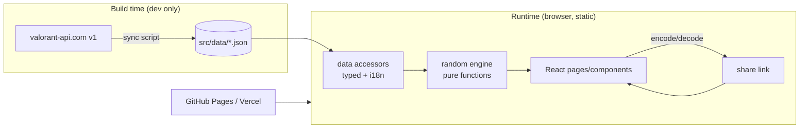

# 02 — Solution Architecture

**Sản phẩm:** VALORANDOM
**Phiên bản:** 1.0

---

## 1. Kiến trúc tổng thể

Static SPA, không backend. Toàn bộ logic random chạy client trong module thuần (pure functions).



**Nguyên tắc:**

1. **Data → Logic → View một chiều.** Component không tự random; mọi quyết định random nằm ở
   `src/features/random/*` là pure function, nhận `(input, rng)` và trả kết quả.
2. **RNG injectable.** `type Rng = () => number`. Mặc định `Math.random`; test dùng
   `mulberry32(seed)` để deterministic.
3. **Không state library.** `useReducer` cho Squad + Context cho i18n.
4. **Không fetch runtime.** Không TanStack Query, không axios, không loading state cho data.
5. **Hash router** (`createHashRouter`) để deep link `#/squad?s=...` hoạt động trên static host.

## 2. Tech stack

### 2.1 Bảng lựa chọn

| Lớp | Lựa chọn | Lý do |
|---|---|---|
| Build | Vite 5 | Dev server/HMR nhanh, build static, bundle nhỏ |
| UI | React 18 + TypeScript strict | Hệ sinh thái animation phong phú, type an toàn cho dữ liệu game |
| Style | Tailwind CSS 3 | Utility-first, theme tối/neon nhanh, không CSS chết |
| Animation | Framer Motion | Card flip, stagger, layout animation mượt |
| Router | react-router-dom 6 (`createHashRouter`) | 2 route, share link, static-host friendly |
| Validation | zod | Validate JSON khi sync + validate share link khi decode |
| Test unit | Vitest + jsdom | Cùng hệ Vite, nhanh |
| Test component | @testing-library/react + user-event | Test theo hành vi người dùng |
| Test e2e | Playwright | Verify luồng thật + clipboard/URL |
| Icon | lucide-react | Nhẹ, tree-shakable |

### 2.2 Danh sách thư viện được phép (không thêm ngoài danh sách này)

Runtime: `react`, `react-dom`, `react-router-dom`, `framer-motion`, `zod`, `lucide-react`.
Dev: `vite`, `@vitejs/plugin-react`, `typescript`, `tailwindcss`, `postcss`, `autoprefixer`,
`eslint` + plugins, `prettier`, `vitest`, `jsdom`, `@testing-library/*`, `@playwright/test`,
`tsx`, `@types/*`.

### 2.3 Không dùng ở v1

SSR/Next.js (không cần SEO), backend (không có dữ liệu riêng tư), state library,
component library nặng (MUI/AntD — phá vỡ ngôn ngữ thiết kế gaming).

## 3. Cấu trúc thư mục

```
D:\Valorandom\
├─ docs/                          # 4 tài liệu chuẩn
├─ scripts/
│  ├─ sync-valorant-data.ts       # valorant-api -> src/data/*.json
│  ├─ map-rotation.json           # maintainer quản lý map đang active
│  └─ validate-data.ts            # kiểm tra integrity JSON
├─ src/
│  ├─ main.tsx
│  ├─ App.tsx                     # router + providers
│  ├─ routes/
│  │  ├─ SingleRandomPage.tsx
│  │  └─ SquadRandomPage.tsx
│  ├─ features/
│  │  ├─ random/
│  │  │  ├─ rng.ts                # Rng, mulberry32, shuffle, pick
│  │  │  ├─ filters.ts            # filter -> predicate
│  │  │  ├─ singleRandom.ts       # randomAgent/Map/Weapon
│  │  │  ├─ squadRandom.ts        # thuật toán đội (pure)
│  │  │  └─ __tests__/
│  │  ├─ single/                  # component Single Random
│  │  └─ squad/
│  │     ├─ squadReducer.ts
│  │     ├─ SquadSlotRow.tsx
│  │     ├─ RoleSelect.tsx
│  │     ├─ AgentPickerPopover.tsx
│  │     ├─ SquadResultTable.tsx
│  │     └─ __tests__/
│  ├─ components/
│  │  ├─ ui/                      # Button, Card, Badge, Select, Toggle, EmptyState
│  │  └─ layout/                  # Header, LangToggle, Footer, PageShell
│  ├─ data/
│  │  ├─ agents.json / maps.json / weapons.json / meta.json
│  │  └─ index.ts                 # typed accessors
│  ├─ lib/
│  │  ├─ shareLink.ts
│  │  ├─ squadState.ts            # factory + helpers dùng chung
│  │  ├─ cn.ts
│  │  └─ i18n/
│  ├─ hooks/
│  ├─ types/
│  │  ├─ valorant.ts
│  │  └─ squad.ts
│  └─ styles/index.css
├─ tests/
│  ├─ setup.ts
│  └─ e2e/
├─ AGENTS.md
└─ configs...
```

**Quy ước:** import tuyệt đối `@/`; file < 250 dòng; component chỉ render; logic ở `features/*`.

## 4. Thuật toán Squad Random

### 4.1 Input / Output

```ts
type Role = 'duelist' | 'initiator' | 'controller' | 'sentinel';
type SlotRole = Role | 'flex';

interface SquadSlot {
  id: string;
  name: string;
  role: SlotRole;
  lockedAgentId: string | null;
}

interface SquadRandomInput {
  slots: SquadSlot[];
  pool: Agent[];      // pool sau filter, mặc định = toàn bộ agent playable
  rng: Rng;
}

interface SquadResult {
  bySlot: Record<string, Agent>;
  order: string[];          // slotId theo thứ tự assign
  warnings: SquadWarning[];
}
```

### 4.2 Các bước

```
1. VALIDATE
   - 1 <= slots.length <= 5, ngược lại -> SquadError('INVALID_SLOT_COUNT')
   - mọi lockedAgentId tồn tại trong pool và unique -> SquadError('INVALID_LOCK')
   - slot có lock và role != 'flex' -> agent.role === slot.role -> SquadError('INVALID_LOCK_ROLE')

2. KHỞI TẠO
   - available = Map(pool.map(a => [a.id, a]))
   - bySlot: Map<slotId, Agent>

3. ÁP DỤNG LOCK (trước mọi bước khác)
   - assigned[slot.id] = lockedAgent
   - available.delete(agent.id)          // không slot nào khác nhận lại

4. GÁN SLOT ROLE CỐ ĐỊNH (chưa lock)
   - shuffle(fixedFreeSlots, rng)        // công bằng thứ tự giữa các slot
   - candidates = available.filter(a => a.role === slot.role)
   - candidates rỗng -> SquadError('INSUFFICIENT_ROLE', { role, needed, available })
   - agent = pick(candidates, rng); available.delete(agent.id)

5. TÍNH ROLE CÒN THIẾU
   - missing = ALL_ROLES.filter(r => !teamRoles.has(r))

6. GÁN SLOT FLEX
   - shuffle(flexFreeSlots, rng)
   - fillable = missing.filter(r => có agent khả dụng)
   - nếu fillable.length > 0:
       role = pick(fillable, rng)
       agent = pick(agentsWithRole(available, role), rng)
       missing = missing.filter(r => r !== role)
     ngược lại:
       available rỗng -> SquadError('EXHAUSTED_POOL')
       agent = pick([...available.values()], rng)

7. RETURN { bySlot, order, warnings }
```

### 4.3 Bất biến (assert trong dev + test)

- **I1:** `bySlot.size === slots.length`.
- **I2:** `new Set(assignedAgentIds).size === slots.length` → không trùng đặc vụ.
- **I3:** mọi slot role ≠ flex có `agent.role === slot.role`.
- **I4:** mọi lock được giữ nguyên.
- **I5:** số Flex lấp vào role thiếu = `min(k, |missing có pool khả dụng|)`.

### 4.4 Tại sao thứ tự này?

Nếu gán Flex trước, Flex có thể "cướp" agent mà slot role cố định cần → thất bại hoặc phải
backtracking. Thứ tự **lock → role cố định → Flex → random tự do** đảm bảo không cần backtracking và
điều kiện bất khả thi được phát hiện đúng bước với thông báo chính xác.

### 4.5 Độ phức tạp

O(n × p) với n ≤ 5, p ≈ 27 agent. Không đáng kể, dễ dàng < 10ms.

### 4.6 Reroll với Lock

`reroll` = chạy lại toàn bộ thuật toán với `lockedAgentId` hiện tại. Mọi slot không lock đều được
random lại (kể cả slot role cố định). Ghi rõ trong UI tooltip.

## 5. Mô hình state

```ts
type SquadAction =
  | { type: 'ADD_SLOT' }
  | { type: 'REMOVE_SLOT'; id: string }
  | { type: 'SET_NAME'; id: string; name: string }
  | { type: 'SET_ROLE'; id: string; role: SlotRole }
  | { type: 'LOCK_AGENT'; id: string; agentId: string }
  | { type: 'UNLOCK_AGENT'; id: string }
  | { type: 'LOCK_ALL'; ids: string[] }
  | { type: 'RANDOMIZE'; result: SquadResult }
  | { type: 'HYDRATE'; state: SquadState };
```

- Kết quả random nằm ở `lastResult`, tách khỏi slot state.
- Lock ghi ngược vào slot (`lockedAgentId`) để share được.
- Ngôn ngữ lưu `localStorage['valorandom.lang']`. Không persist state đội (chỉ qua share link).

## 6. Design system

- **Palette:** nền `#0B0F14` / elevated `#11161D`, surface `#1A2029`, line `#2A333F`,
  accent neon `#FF4655` + secondary `#00E5C0`, ink `#E8EDF2` / muted `#8A97A6`.
- **Role color:** duelist `#FF6B6B`, initiator `#F5C453`, controller `#8B7CF6`,
  sentinel `#3DDC97`, flex `#5AA9E6`.
- **Type:** heading "Chakra Petch" uppercase tracking rộng, body "Inter".
- **Hiệu ứng:** glow nhẹ quanh card khi hover, card flip 400ms khi ra kết quả, stagger 60ms cho slot.
- **Ràng buộc:** chỉ animate `transform`/`opacity`; tôn trọng `prefers-reduced-motion`.

## 7. Rủi ro kiến trúc

| ID | Rủi ro | Mức | Giảm thiểu |
|---|---|---|---|
| R1 | valorant-api.com đổi schema → sync script vỡ | Cao | zod validate; JSON đã commit nên app không ảnh hưởng |
| R2 | Ảnh từ `media.valorant-api.com` cần mạng | TB | Lazy load + fallback placeholder |
| R3 | Pool agent thay đổi theo mùa | TB | Footer hiện `generatedAt`; chạy `npm run data:sync` |
| R4 | Map rotation không có trong API | TB | Cờ `active` từ `scripts/map-rotation.json`, có test integrity |
| R5 | Share link chứa agent đã bị xoá khỏi pool | Thấp | Validate agentId khi decode, bỏ lock + warning |
| R6 | Flex "thông minh" gây hiểu nhầm | Thấp | Tooltip + hiện role thực tế trong bảng kết quả |
