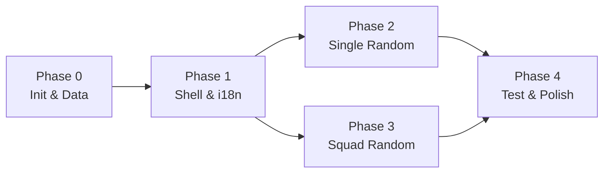

# 04 — Implementation Plan

**Sản phẩm:** VALORANDOM
**Phiên bản:** 1.0

Nguyên tắc: mỗi Phase là một mốc chạy được (build + test pass). Task có ID để agent thực thi
tuần tự và báo cáo chính xác.

---

## Phase 0 — Init & Setup

**Mốc:** `npm run dev` chạy, `npm test` pass, `npm run build` pass, dữ liệu thật đã có trong repo.

| Task | Nội dung | Verify |
|---|---|---|
| P0-01 | Khởi tạo Vite + React + TS, `tsconfig` strict, alias `@/*` | `npm run build` pass |
| P0-02 | Tailwind 3 + postcss + design tokens trong `tailwind.config.ts` + `styles/index.css` | Nền tối đúng token |
| P0-03 | Materialize `docs/01..04` | 4 file tồn tại |
| P0-04 | `AGENTS.md` với constraints | Nội dung rõ ràng |
| P0-05 | Vitest + jsdom + RTL + `tests/setup.ts` | `npm test` chạy |
| P0-06 | Playwright + `playwright.config.ts` | `npm run test:e2e` chạy |
| P0-07 | ESLint + Prettier + `.gitignore` | `npm run lint` sạch |
| P0-08 | `scripts/sync-valorant-data.ts` + zod + `scripts/map-rotation.json` → sinh 3 JSON | agents ≥ 25, maps ≥ 10, weapons ≥ 18 |
| P0-09 | `scripts/validate-data.ts` + test data-integrity (AC-02.1) | Test pass |
| P0-10 | Router hash, `App.tsx`, `PageShell`, `Header`, `Footer`, 2 route | `/` ↔ `/squad`, reload không 404 |

## Phase 1 — Core Data Layer & UI Shell

**Mốc:** 2 trang render dữ liệu thật, i18n hoạt động, chưa có logic random.

| Task | Nội dung | Verify |
|---|---|---|
| P1-01 | `types/valorant.ts` + `types/squad.ts` | `tsc --noEmit` pass |
| P1-02 | `data/index.ts` accessors + `localize` | Unit test pass |
| P1-03 | i18n Provider + `useI18n` + dict VI/EN + LangToggle persist | AC-01.2, key parity |
| P1-04 | UI primitives: Button, Card, Badge, Select, Toggle, Tooltip, EmptyState | Component test |
| P1-05 | `AgentCard`, `MapCard`, `WeaponCard` (presentational, lazy ảnh + fallback) | Component test |
| P1-06 | Layout trang Single Random (3 panel, đếm pool) | Render sạch |
| P1-07 | `useReducedMotion` + `aria-live` region dùng chung | Test a11y cơ bản |

## Phase 2 — Single Random

**Mốc:** 3 loại random hoạt động + filter + animation.

| Task | Nội dung | Verify |
|---|---|---|
| P2-01 | `rng.ts`: `mulberry32`, `shuffle`, `pick` | Determinism test |
| P2-02 | `filters.ts` + `singleRandom.ts` | AC-10.x, 11.x, 12.x, 13.2 |
| P2-03 | `useRandomizer` hook | Hook test |
| P2-04 | Agent panel + filter role + card flip + reroll | e2e |
| P2-05 | Map panel + filter active + site badges | AC-11.2 |
| P2-06 | Weapon panel + filter category/cost + stats | AC-12.1 |
| P2-07 | Empty state + disable Random | AC-04.1 |
| P2-08 | Random combo Agent+Map+Weapon (Ft-14) | Manual |

## Phase 3 — Squad Random

**Mốc:** tính năng trọng tâm hoàn chỉnh + share link.

| Task | Nội dung | Verify |
|---|---|---|
| P3-01 | `squadRandom.ts` theo 7 bước + `SquadError` (TDD) | AC-21.1/2/3, 22.1/2, 25.1 |
| P3-02 | `squadReducer.ts` + test từng action | Reducer test |
| P3-03 | `SquadSlotRow` + `RoleSelect` + lock/unlock | AC-20.x, 23.1 |
| P3-04 | `AgentPickerPopover` (loại agent đã lock ở slot khác) | AC-23.3 |
| P3-05 | `SquadResultTable` + badge cảnh báo + responsive | Ft-26, NFR-4 |
| P3-06 | Nút Random + stagger + aria-live + disabled khi lock all | AC-23.2 |
| P3-07 | `shareLink.ts` encode/decode + zod + toast/banner | AC-24.x, AC-04.2 |
| P3-08 | Hydrate từ `?s=` khi mount | e2e |
| P3-09 | Map `SquadError.code` → message i18n | Test từng code |

## Phase 4 — Testing, Polish & Release

**Mốc:** unit/component/e2e pass, build deploy được, AC checklist ký.

| Task | Nội dung | Verify |
|---|---|---|
| P4-01 | e2e `single-random.spec.ts` + chứng minh không gọi mạng | AC-01.1 |
| P4-02 | e2e `squad-random.spec.ts` (lock + reroll + share/hydrate) | AC-23.1, 24.1 |
| P4-03 | A11y: keyboard toàn luồng, focus ring, aria-live, contrast | 0 violation nghiêm trọng |
| P4-04 | Responsive 360/768/1440 + reduced-motion | Manual + e2e |
| P4-05 | Bundle size + lazy ảnh; đo LCP | < 200KB gzip (NFR-1) |
| P4-06 | Metadata: title, description, favicon, theme-color, OG | Manual |
| P4-07 | Fallback ảnh lỗi hiển thị placeholder | Manual |
| P4-08 | CI workflow: lint + typecheck + test + build (+ e2e) | CI xanh |
| P4-09 | README: chạy, sync data, cấu trúc, deploy | Người mới chạy được |
| P4-10 | Final AC checklist | 100% pass hoặc có note |

## Thứ tự phụ thuộc

## Ma trận test

| Lớp | File dự kiến | AC phủ |
|---|---|---|
| Unit — data integrity | `src/data/__tests__/data.test.ts` | AC-02.1 |
| Unit — rng | `features/random/__tests__/rng.test.ts` | AC-13.2 |
| Unit — single random | `features/random/__tests__/singleRandom.test.ts` | AC-10.x, 11.x, 12.x |
| Unit — squad random | `features/random/__tests__/squadRandom.test.ts` | AC-21.x, 22.x, 25.1 |
| Unit — squad reducer | `features/squad/__tests__/squadReducer.test.ts` | AC-20.x, 23.1 |
| Unit — share link | `lib/__tests__/shareLink.test.ts` | AC-24.2, AC-04.2 |
| Unit — i18n | `lib/i18n/__tests__/i18n.test.ts` | AC-01.2 |
| Component | `components/ui/__tests__/*`, `features/squad/__tests__/*` | AC-04.1, AC-20.x, 23.3 |
| E2E | `tests/e2e/single-random.spec.ts` | AC-01.1 |
| E2E | `tests/e2e/squad-random.spec.ts` | AC-23.1/2, AC-24.1 |
| Manual | checklist | AC-13.1, NFR-2/3/4 |

## AC checklist (ký trước release)

- [x] AC-01.1, AC-01.2, AC-01.3
- [x] AC-02.1
- [x] AC-04.1, AC-04.2
- [x] AC-10.1, AC-10.2, AC-10.3
- [x] AC-11.1, AC-11.2
- [x] AC-12.1
- [x] AC-13.1 (manual), AC-13.2
- [x] AC-20.1, AC-20.2, AC-20.3
- [x] AC-21.1, AC-21.2, AC-21.3
- [x] AC-22.1, AC-22.2
- [x] AC-23.1, AC-23.2, AC-23.3
- [x] AC-24.1, AC-24.2, AC-24.3
- [x] AC-25.1
